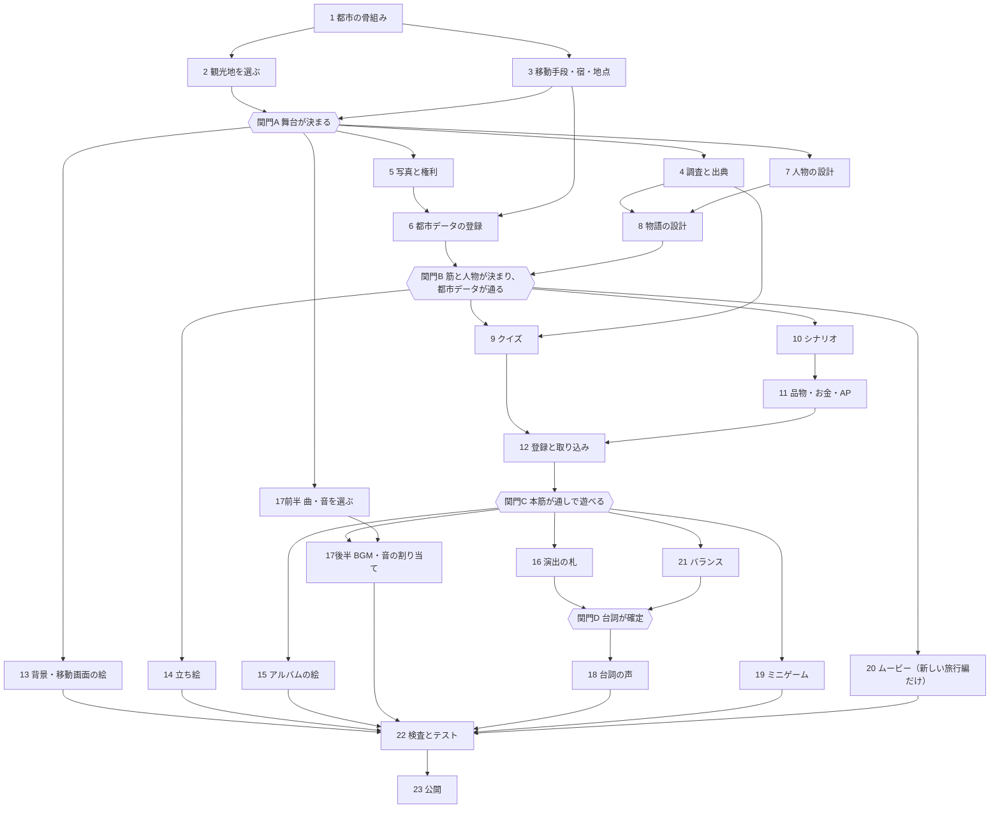

# 新しい都市を1つ足す手引き

Dreamscape に都市を1つ足すときの、作業の順番の手引きです。どの作業を先にし、どれを同時に進められるかを示します。書き方の細かい決まりは、各手順に挙げた資料にあります。

- ここに書いたコマンド・項目・ファイルは、2026-11-13 のリポジトリにあるものです。まだないものは「まだ仕組みがない」と書きます。
- 決まりの元は [AGENTS.md](../AGENTS.md) です。この手引きと食い違うときは AGENTS.md に従います。
- 例はインド・ゴールデントライアングル編です（旅行編ID `golden_triangle`、接頭辞 `gt`、デリー・アーグラ・ジャイプール）。ファイルの書き方の手本は、架空の街の[見本の編](templates/sample_trip/README.md)です。

この文書での書き方：

| 書き方 | 意味 |
| --- | --- |
| `<旅行編>` | `content/journeys/<旅行編ID>/`（ゲームが読むデータ） |
| `<制作資料>` | `authoring/journeys/<旅行編ID>/`（ゲームは読まない。調査・下書き・元の絵） |
| `<頭>` | `<接頭辞>_<都市ID>`（例 `gt_delhi`）。会話・クイズの名前の頭（[IDの付け方](../docs/02_TECH_ARCHITECTURE.md#idの付け方)） |
| 止まる | `npm run content:build` がエラーで生成を止める |
| 注意 | `npm run content:build` が警告を出す（生成は止めない。一覧は `-- --verbose`） |

## 目次

- [2つの場合](#2つの場合)
- [1. 完成した都市の中身](#1-完成した都市の中身)
- [2. 作る順番](#2-作る順番)
- [3. 同時に進める](#3-同時に進める)
- [4. インド編はこの順に作った](#4-インド編はこの順に作った)
- [5. まだ仕組みがないこと](#5-まだ仕組みがないこと)
- [6. 1枚のチェックリスト](#6-1枚のチェックリスト)

## 2つの場合

作業の中身はどちらもほぼ同じです。違うのは、旅行編全体の設定を新しく決めるか、今の設定に合わせるかです。本文の手順は両方に共通です。

### A. ある旅行編に都市を足す（例：ゴールデントライアングル編の4つ目の都市）

- 専用のブランチで作業します。`manifest.json` に都市IDを足すと、都市データを反映するまで `journey:readiness`・`journey:transit` が止まります（`Missing content file: cities/<都市ID>.json`）。`content:build` は通ります（[CITY_BUNDLES](CITY_BUNDLES.md)）。
- `<旅行編>/manifest.json` の `cities` に `{ "id": "<都市ID>", "nameJa": "<都市名>" }` を、旅の順の位置に足します。`nameJa` は都市ファイルの `nameJa` と同じにします（違うと止まる）。
- 都市データの雛形は `npm run city:bundle -- new <都市ID> artifacts/city-work/<名前>.json` で作ります（手順6）。
- 前の都市の `cities/<前の都市ID>.json` の `nextCityId` に新しい都市を書きます。書けるのは `manifest.json` で次の順にある都市だけです。新しい都市が制作中（`productionStatus: "prototype"`）でも書けます。次の都市が公開されるまで、遊ぶ人は前の都市にとどまります（[FUTURE_CITIES](FUTURE_CITIES.md)）。
- 旅行編の設定は全都市に効きます。次の点に気をつけます。
  - 乗り物：`transportModes` は旅行編ごとに徒歩のほかに2つまでです。新しい都市はその中から使います。インド編ならオートリキシャ（`auto_rickshaw`）と地下鉄（`metro`）です。3つ目を足すと止まります。都市ごとに乗り物を変える仕組みはまだありません。
  - 件数：`cityPlan` の `mainTourismCount`（本筋の観光の数）と `dateCount`（行き先のある通常デートの数）は、どの都市にも同じ数を求めます。違うと `journey:readiness` が `event_count_mismatch` を出し、`journey:release` が止まります。インド編は本筋4件・デート6件です。`cityClearAp` と `lodgingCost` も全都市で同じです（違うと止まる）。
  - 予算：`initialBudget` は旅全体の残高です。都市が増えると、いちばん安く回るのに要る額も増えます。インド編は `tests/journeys/golden_triangle/budget.test.ts` が全都市の合計を確かめるので、予算を見直します（手順21）。
  - 都市の移り方：インド編は `cityTransition: "after_epilogue"` です。前の都市のエピローグを読み終えると、次の都市へ移ります。
  - オープニングムービーとタイトルの絵は旅行編に1つだけです。新しい都市には作りません。代わりに都市の到着（ロゴと到着の会話）を作ります。
- 公開中の旅行編では、公開済みのIDを変えません。交通費を上げる・経路をなくすときは、セーブの版を上げます（[データ契約のセーブの版](../docs/07_DATA_AND_TESTS.md#セーブの版)）。
- その旅行編の単体テスト（`tests/journeys/<旅行編ID>/`）と共通のテストが都市の数や都市名・予算を前提にしていれば直します（例：`src/content/journeys.test.ts` はインド編の都市の並び・予算・`cityPlan` を確かめる）。
- 公開は `npm run journey:release -- --check --journey <旅行編ID> --through <新しい都市ID>` からです。公開済みの都市は書き直さず、新しい都市まで順に反映します（手順23）。

### B. 新しい旅行編の最初の都市（journey:new）

- 見本の編を写して、準備中の旅行編を作ります。

  ```sh
  npm run journey:new -- <旅行編ID> --name <旅行編の日本語名> --city <都市ID> --city-name <都市の日本語名> [--prefix <接頭辞>] [--with-optional]
  ```

- `--with-optional` を付けると、推理クイズB・C、道中交流と品物、貸し自転車などの任意の部分も写します。外し方は見本の編の README の「任意の部分」にあります。
- 作った旅行編の `CHECKLIST.md` に、置き換えるものが並びます。手順は[技術設計の「新しい編を追加する手順」](../docs/02_TECH_ARCHITECTURE.md#新しい編を追加する手順)にあります。
- 旅行編で決めるもの（`manifest.json`）：通貨 `currency`、初めの予算 `initialBudget`、初めの状態 `initialState`、都市の計画 `cityPlan`、暦 `startWeekday`（任意）、都市の移り方 `cityTransition`、運賃の人数 `farePartySize`、都市間の乗り物 `intercityModes`、乗り物 `transportModes`（手順3）、タイトルの絵 `titleArt`（手順13）、オープニングムービー `openingMovie`（手順20）、声の出典 `voiceCredits`（手順18）。`authoring`（`eventPrefix`・`observationFile`・`imageDirectory`）は `journey:new` が書きます。
- 見本の出典・画像・文章が残っている間は、`journey:readiness` が `sample_content_left` で示し、`journey:release` が止まります。
- 旅行編の状態 `status` は手で `available` にしません。`journey:release -- --apply` が変えます。
- 2つ目からの都市は、A と同じ手順で足します。

## 1. 完成した都市の中身

都市は、次の部品でできています。「最小」は遊べる最小の形に要るもの、「仕上げ」はなくても遊べるものです。最小の形は見本の編で確かめられます（宿と時計塔の2地点、観光1・通常のクイズ1・デート1・都市フィナーレ・エピローグ。`npm run dev:sample` で遊べる）。

| 部品 | 置き場所 | 区分 |
| --- | --- | --- |
| 都市の登録 | `<旅行編>/manifest.json` の `cities`、`<旅行編>/cities/<都市ID>.json` | 最小 |
| 地点・地図の出来事・経路 | `<旅行編>/travel/<都市ID>.json`（`places`・`events`・`routes`） | 最小 |
| 宿と都市の設定 | `<旅行編>/travel/<都市ID>-settings.json` | 最小 |
| 交通判断台帳 | `<旅行編>/travel/<都市ID>-transit.json` | 乗り物を宣言した旅行編では最小 |
| 観光写真と権利 | `<旅行編>/public/assets/tourism/…`、`<旅行編>/tourism/catalog.json` の `assets` | 最小 |
| 観光地 | `tourism/catalog.json` の `landmarks` | 最小 |
| 観察ポイント | `tourism/catalog.json` の `clues` | 観察を入れる観光地（`observation: false` を書かない観光地）では最小（ないと `journey:readiness` が `observations_missing`）。推理クイズの証拠にも要る |
| 会話の背景 | `<旅行編>/romance/presentation.json` の `backgrounds` | 最小 |
| 本筋・フィナーレ・報酬 | `<旅行編>/progression/journey.json` の `episodes`・`rewards` | 最小 |
| クイズの相手（対決） | `<旅行編>/battles/catalog.json` | 最小 |
| クイズ（通常3問・フィナーレ5問） | `<旅行編>/quizzes/<クイズID>.json` | 最小 |
| 和訳・単語の意味 | `<旅行編>/learning/translations.json`・`word-meanings.json` | 最小 |
| 名前で話す人 | `<旅行編>/progression/story.json` の `people` | 名前で話す人がいれば最小 |
| 会話（Ink） | `<旅行編>/stories/places/<頭>_<場所>.ink` | 対決とエピローグは最小。案内・到着・差し込みは仕上げ |
| デート・行き先・思い出 | `romance/date_catalog.json`・`date_destinations.json`、`presentation.json` の `memories` | 数は `cityPlan.dateCount` |
| 推理クイズB・C | `battles/catalog.json`、`progression/journey.json` の `storyBattles` | 仕上げ（物語に合うときだけ） |
| 道中交流・差し込みの場面の出典 | 場所のファイルの knot、`<旅行編>/scenes/catalog.json` | 仕上げ |
| 品物 | `<旅行編>/encounters/catalog.json` の `items` | 仕上げ |
| ツアー | `<旅行編>/tours/<ツアーID>.json` | 仕上げ |
| その国の言葉 | `<旅行編>/learning/local-words.json` | 仕上げ |
| 立ち絵 | `<旅行編>/presentation/characters.json`、`public/assets/characters/` | 仕上げ（ないと抽象の表示） |
| 自由時間の背景 | 都市の `backdropImagePath` か `backdropAssetId` | 仕上げ |
| アルバムの絵 | `<旅行編>/public/assets/album/<ID>.webp` | 仕上げ |
| 自作の絵の一覧 | `<旅行編>/presentation/own-artwork.json` | 自作の絵を配信するなら必須 |
| BGM・環境音・効果音 | `public/assets/bgm/`・`ambience/`・`se/`、`presentation/music.json`・`ambience.json`・`sounds.json` | 仕上げ |
| 台詞の声 | `<旅行編>/public/assets/voice/<ID>.mp3`、`manifest.json` の `voiceCredits` | 仕上げ |
| 地点の紹介文・彼女のひと言・夜の一言 | `travel/<都市ID>.json` の `descriptionJa`・`heroineLinesJa`・`nightLinesJa` | 仕上げ |
| 旅行編のテスト | `tests/journeys/<旅行編ID>/` | 予算のテストを置くことを勧める（手順21） |

## 2. 作る順番

番号は「だいたいこの順に始める」順です。同時に進めてよい手順は、次の章「[3. 同時に進める](#3-同時に進める)」にまとめます。

| 番号 | 手順 | 段階 |
| --- | --- | --- |
| 1 | 都市の骨組みを決める | 企画 |
| 2 | 観光地を選ぶ（本筋・推理クイズ・フィナーレ・デート・道中交流） | 企画 |
| 3 | 移動手段を選ぶ（徒歩＋著名な乗り物2つ）・宿・地点と経路 | 企画 |
| 4 | 調べて出典を記録する | 調査 |
| 5 | 観光写真を選び、権利を確かめる | 調査 |
| 6 | 都市データを登録する | データ |
| 7 | 人物を設計する | 脚本 |
| 8 | 都市の物語を設計する | 脚本 |
| 9 | クイズを作る（英文・和訳・単語） | 脚本 |
| 10 | シナリオ（Ink）を書く | 脚本 |
| 11 | 品物・お金・APの効果を書く | 脚本 |
| 12 | カタログへ登録し、下書きを本番へ移す | データ |
| 13 | 背景・移動画面・タイトルの絵 | 絵 |
| 14 | 立ち絵と大きさ | 絵 |
| 15 | アルバムの絵 | 絵 |
| 16 | 演出の札を付ける | 仕上げ |
| 17 | BGM・環境音・効果音 | 音 |
| 18 | 台詞の声 | 音 |
| 19 | ミニゲーム | 仕上げ |
| 20 | オープニングムービー（新しい旅行編だけ） | 映像 |
| 21 | バランスを調整する | 調整 |
| 22 | 検査とテスト | 確認 |
| 23 | 公開する | 公開 |

各手順は次の形で書きます：目的／前に要るもの／作るものと置き場所／守る決まり／確かめ方と終わりの目安／インド編では。

### 手順1. 都市の骨組みを決める

- 目的：何を作るかの枠を決める。後の作業が同じ前提で進むようにする。
- 前に要るもの：なし。足す旅行編の `manifest.json`（場合A）。
- 作るもの：
  - 都市ID（英小文字・数字・`_`）、日本語名、旅の中での順番、都市のテーマ（`themeJa`）。
  - 接頭辞（場合B。旅行編の `authoring.eventPrefix`。例 `gt`）。ほかの旅行編と重ならないもの。
  - この都市で語りたいこと（ヒロインとの関係の段階、旅の中での役目）を数行。
  - 置き場所：`<制作資料>/drafts/` のメモ（例 `drafts/README.md`）。
- 守る決まり：見本の編の名前（旅行編ID `sample_trip`、接頭辞 `smp`、都市ID `mihon`、`order: 9000`）は使えません。公開後はIDを変えません（[必要な安定ID](../docs/07_DATA_AND_TESTS.md#必要な安定id)）。
- 確かめ方と終わりの目安：場合Aなら、乗り物と件数（`cityPlan`）の制約を読み、この都市で守れると分かる。場合Bなら、`journey:new` のコマンドを書ける。
- インド編では：3都市を同じ骨組みにし、各都市を本筋4件・デート6件・フィナーレ5問・都市クリア4APにした（`manifest.json` の `cityPlan`）。

### 手順2. 観光地を選ぶ

- 目的：都市の舞台を決める。調査・写真・物語はすべてここから始まる。
- 前に要るもの：手順1。
- 作るもの：役目ごとの観光地の一覧（`<制作資料>/drafts/` か `research/`）。各行に、地点ID案（都市IDで始める。例 `delhi_red_fort`）、日本語名・英語名、営業時間、休みの曜日、入場料（2人分）の見込みを書く。

| 役目 | 数の目安 | 決まり |
| --- | --- | --- |
| 本筋の観光（通常のクイズ3問） | `cityPlan.mainTourismCount`（インド編4） | 実在する著名な観光地を主舞台にする |
| 推理クイズB（矛盾追及）・C（証拠連結） | 物語に合うときだけ（稀） | 実在する著名な観光地を主舞台にする。BとCは互いに主舞台を重ねない（『最後の晩餐』とも重ねない）。その場所固有の資料で推理する |
| 都市フィナーレ（5問） | 1 | 実在する著名な観光地を主舞台にする。複数の観光地の知識や出会いを回収する |
| デートの行き先 | `cityPlan.dateCount`（インド編6）＋告白などの特別なデート | 名所を明示し、その場所ならではの体験にする。本筋の観光地と同じ場所でもよい（データは別） |
| 道中交流・差し込みの場面 | 自由 | 名所を明示し、その場所ならではの体験にする |
| 宿 | 1 | 架空の宿でよい（画面では「滞在先のホテル」と出る） |

- 守る決まり：
  - 本筋・推理クイズ・フィナーレは実在する著名な観光地（[AGENTS.md の「観光と学習」](../AGENTS.md)）。
  - 観察は任意です。観察を入れるか、案内・観察・クイズをどの順にするかは、場所ごとに決めます（`tourism/catalog.json` の `observation: false`・`order`）。
  - ゲームの行動は9:00〜21:00、夜は18:00からです。フィナーレはその地点の営業時間内に始まります。夜の場面は、物語の中で時間を進めてから描きます（[インド編改稿の設計](journeys/golden_triangle/drafts/SCENARIO_REWRITE.md)の7章）。
  - ツアーでだけ行く遠い地点（`"access": "tour"`）も作れます（[CONTENT_GUIDE のツアー](CONTENT_GUIDE.md#ツアー決まった行程の日帰り)）。
- 確かめ方と終わりの目安：一覧のどの行にも役目がある。推理クイズの主舞台が重ならない。この段階を確かめるコマンドはありません（台本の点検で見る）。
- インド編では：デリーは本筋がレッド・フォート、クトゥブ・ミナール、フマユーン廟、ジャーマー・マスジド。推理クイズB・Cはない。アーグラのフィナーレはタージ・マハル、ジャイプールはハワー・マハル（物語に合わせて地点を移した）。推理クイズの例はミラノ編（Bはスカラ座、Cはブレラ）。

### 手順3. 移動手段を選ぶ（徒歩＋著名な乗り物2つ）・宿・地点と経路

- 目的：街の中の動き方を決める。時間とお金の遊びの土台になる。
- 前に要るもの：手順1。乗り物と宿は手順2と並べて選べる。地点と経路は手順2の一覧の後。
- 作るもの：
  - 乗り物の宣言（`manifest.json` の `transportModes`）：`{ id, nameJa, movingJa, kind, rental?, se? }`。`kind` は演出の絵で、`rail`・`tram`・`bus`・`car`・`three_wheeler`・`bicycle` から選ぶ。徒歩（`walk`）は宣言しない。借りる乗り物は `"rental": true` と、設定の `rentals`。
  - 宿と都市の設定（`travel/<都市ID>-settings.json`）：`hotelPlaceId`、`initialBudget`、`lodgingCost`（`cityPlan.lodgingCost` と同じ）、`retryMinutes`、`notes`（ゲーム用の前提のメモ）、任意の `storyBackgroundId`・`rentals`。
  - 地点（`travel/<都市ID>.json` の `places`）：`id`・`cityId`・`nameJa`・`nameEn`・`latitude`・`longitude`・`backgroundId`・`sources`、任意の `openingWindows`・`closedWeekdays`。観光地の地点は `landmarkIds`、デートの地点は `destinationIds` で観光地・行き先を指す（合わないと止まる）。
  - 地図の出来事（同じファイルの `events`）：エピソード・推理クイズ・デートと同じID、`cityId`・`placeId`・`category`（`main`・`date`）・`titleJa`・`activityMinutes`・`apCost`（本筋は0、デートはデートの `apCost` と同じ。違うと止まる）・任意の `admissionCost`（2人分）。脚本がまだない出来事は `"contentStatus": "pending_content"`（制作中の都市だけ。`journey:release -- --apply` が外す）。
  - 経路（`routes`）：片道ごとに `fromPlaceId`・`toPlaceId`・`mode`・`minutes`・`cost`（片道の `farePartySize` 人分）・`estimation: "game_model"`・`sources`・任意の `transferNote`（40字まで。超えると止まる）。各地点に同じ地点への徒歩0分の経路も置く（ないと止まる）。
  - 交通判断台帳（`travel/<都市ID>-transit.json`、`schemaVersion: 2`）：地点の組（向きを区別）×乗り物ごとに `available`・`not_suitable`・`not_applicable`・`inconclusive` と、`checkedAt`・`reasonJa`・出典。
  - 地点・経路・台帳は手順6の都市の作業用JSON（`city:bundle`）でまとめて書ける。
- 守る決まり：
  - 乗り物は旅行編で徒歩のほかに2つまで（場合Aでは今の2つから選ぶ）。
  - 乗り物の経路は、ゲーム用の推定の印と事実の出典（`documented_fact`）を持つ。推定の根拠は `hypothesis` の出典にする。資料のない仮の値は、台帳の理由にそう書く。
  - 借りる乗り物がなくても、すべての地点へ行けて宿に帰れるようにする（止まる）。
  - 直線距離から実際の徒歩時間を作らない。経路にない公共交通を「ない」と決めつけない（`not_suitable` は「ゲームで使わない」の意味）。
  - 現地で確かめたことを出典にするときは、`<制作資料>/research/` に確認メモを置き、そのメモを `documented_fact` として引く。日付を記録していなければ月までを書き、日付を作らない（[CONTENT_GUIDE の「都市内の移動」](CONTENT_GUIDE.md)）。
- 確かめ方と終わりの目安：
  - `npm run journey:transit -- --journey <旅行編ID>`：都市・乗り物ごとの判断の数、徒歩の経路がない向き、出典のない経路を出す。「特定できず」が残ると終了コード1。
  - `npm run content:build` の注意：徒歩の経路がない向き、出典のない経路、どの都市も使わない乗り物（`unusedTransportModes`）。
  - Debug で制作中の都市の地図と交通を見る：`/?debug&city=<都市ID>&scene=map`。
  - 終わりの目安：「特定できず」が0件。どの地点にも徒歩か借りない乗り物で行けて、21時までに宿へ帰れる。
- インド編では：徒歩・オートリキシャ・地下鉄（2026-11-09 に切り替え。セーブ v15）。デリーのオートの運賃はデリー政府の告示から計算した。調査は [交通の調査記録](journeys/golden_triangle/research/golden-triangle-transport-20261107/README.md)、台帳は `travel/delhi-transit.json`。

### 手順4. 調べて出典を記録する

- 目的：クイズ・案内・デートの小話を、確かめた事実の上に作る。
- 前に要るもの：手順2（何を調べるか）。
- 作るもの：
  - 調査記録：`<制作資料>/research/<調査名>-<日付>/README.md`（例 `research/golden-triangle-20261103/`）。
  - 小話ごとに、日本語で「話の入口」「何を知りたいかという問い」「答えで見え方が変わる種明かし」を先に書く（[CONTENT_GUIDE の「題材を選ぶ」](CONTENT_GUIDE.md#題材を選ぶ)）。
  - 出典の形はどこでも同じ：`publisher`・`title`・`url`・`checkedAt`・`claimType`・`claimJa`。`claimType` は `documented_fact`（事実）・`interpretation`（解釈）・`legend`（伝説）、ゲーム用の推定は `hypothesis`（クイズの問いと `scenes/catalog.json` の出典には `hypothesis` は書けない）。
- 出典を書く所：

| 何の出典か | 書く所 |
| --- | --- |
| 観察ポイント | `tourism/catalog.json` の `clues[].sources` |
| クイズの問い | `quizzes/<クイズID>.json` の各問の `sources` |
| デートの行き先の小話 | `romance/date_destinations.json` の `facts` |
| 会話・道中交流・ツアーの語り（`# scene: talk`・`encounter`・`tour_leg`） | `scenes/catalog.json`（場面のID）。土地の事実を言わない場面は knot の頭に `# sources: none`。どちらもないと止まる |
| 地点・経路 | `travel/<都市ID>.json` の `sources` |
| その国の言葉 | `learning/local-words.json` の `sources` |

- 守る決まり：出典や確認日を捏造しない。未確認なら未確認と書く。事実・解釈・仮説・伝説を分ける。材料・寸法・年号・名前だけの暗記を主題にしない（[AGENTS.md](../AGENTS.md)）。開けなかったページ、検索結果に出ただけの数字は出典にしない（CONTENT_GUIDE のツアーの項）。
- 確かめ方と終わりの目安：事実の正しさを確かめるコマンドはありません（人が資料の該当箇所を読む）。`content:build` は出典の形と、`claimJa` などの日本語の欄に日本語があるか（注意）を見ます。終わりの目安は、作る予定のクイズ・小話のどれにも、確かめた出典がある。
- インド編では：最初に地点・交通・入場料・画像の調査をまとめ（[全調査統合版](journeys/golden_triangle/research/golden-triangle-all-research-20261103/README.md)）、出典の優先順位も記録した。

### 手順5. 観光写真を選び、権利を確かめる

- 目的：観光地とデートの背景、観察、答えの後の写真の種明かしに使う写真をそろえる。
- 前に要るもの：手順2。都市データの登録（手順6）より先に要る（`city:bundle` の `new`・`export` は、画像を先に置いてから使う）。
- 作るもの：
  - 写真のファイル：`<旅行編>/public/assets/tourism/<フォルダ>/<名前>.webp`（インド編のフォルダは `manifest.json` の `authoring.imageDirectory` の `assets/tourism/india`）。
  - 画像の台帳：`tourism/catalog.json` の `assets` に、`id`・`path`（`public/` を除いた配信時のパス）・`width`・`height`・`altJa`・`isPlaceholder: false`・`sourceUrl`・`licenseName`・`licenseUrl`・`creditJa`・`modificationJa`・`checkedAt`。
  - 背景：`romance/presentation.json` の `backgrounds` に `imageAssetId`（任意で `imagePosition`）。写真がない背景は `fallback: "neutral"`。
- 守る決まり：
  - 写真家の権利と、写っているもの（被写体）の権利を確かめる。AIで作った図を、実物の細部の根拠にしない。
  - 配信する写真は WebP（品質80）。JPEG・PNG は `npm run images:optimize -- --journey <旅行編ID>` で確かめ、`--write` で変換する（`path`・寸法・`modificationJa` も書き換わる）。
  - 配信する画像は、出典つきの観光画像か、自作の絵の一覧（`presentation/own-artwork.json`）のどちらか一方（どちらでもないと「出典のない画像」で止まる）。
- 確かめ方と終わりの目安：`npm run content:build` が通る。変換できる写真が残ると注意が出る。写真を差し替えたら、観察の `region`・問いの `revealRegion`・観察資料の SHA-256 も見直す。
- インド編では：Wikimedia Commons などの写真を、作者・ライセンス・加工を書いて使った（例 `gt_img_agra_agra_fort`）。画像のなかった所に後から写真を入れた（#54）。

### 手順6. 都市データを登録する

- 目的：手順3・5を、ゲームが読む形にして検査に通す。
- 前に要るもの：手順3、手順5（画像を先に置く）。場合Bは `journey:new` を済ませておく。
- 作るもの：
  - 場合A：`manifest.json` の `cities` に都市を足し、雛形を作って編集・検査・反映する。

    ```sh
    mkdir -p artifacts/city-work
    npm run city:bundle -- new <都市ID> artifacts/city-work/<名前>.json
    npm run city:bundle -- check artifacts/city-work/<名前>.json
    npm run city:bundle -- apply artifacts/city-work/<名前>.json
    ```

  - 場合B：`journey:new` が作った都市を、`npm run city:bundle -- export <都市ID> artifacts/city-work/<名前>.json` で書き出し、実在のデータに置き換えて `check`・`apply` する。
  - 作業用JSONには、都市・地点・経路（`routeSources` と `sourceRef`）・宿の設定・デートの行き先・観光地・観察ポイント・背景・画像・交通判断が入る（[CITY_BUNDLES](CITY_BUNDLES.md)）。
  - 都市ファイル（`cities/<都市ID>.json`）：`countryCode`・`nameJa`・`themeJa`・`landmarkIdsPlanned`・`firstClearReward`（`rewardSourceId` は `<頭>_first_clear`。インド編は `ap: 0` で、都市クリアのAPは別の `city_clear` 報酬）・`productionStatus`（制作中は `prototype`）、任意の `nextCityId`・`arrivalStoryId`・`backdropImagePath` か `backdropAssetId`。
  - 場合A：前の都市の `nextCityId`。
- 守る決まり：作業用JSONは編集用の写しで、正本は `content/` です。書き出しは `content/`・`public/` の外へ。`baseFingerprint` は手で変えない。地点・出来事のIDは都市をまたいで重ねない。
- 確かめ方と終わりの目安：
  - `npm run content:build` が通る。旅行編ごとの1行（`Journey …`）で、都市・配信ファイル・カタログの数が増えたことを見る。
  - `npm run journey:readiness -- --journey <旅行編ID>` で、残りが脚本・クイズなどの未制作の項目だけになる。
  - `npm run dev` のタイトル画面に準備中の旅行編が並ぶ（場合B）。`/?debug&city=<都市ID>&scene=map` で地図と交通を見る。
- インド編では：3都市の地点・交通・背景を先に登録し（#1〜#3 の旅行の土台）、脚本はその後に足した。

### 手順7. 人物を設計する

- 目的：クイズの相手、道中で出会う人、ヒロインの振る舞いを決める。文章の面白さの土台。
- 前に要るもの：手順2（どこで出会うか）、手順4（その場所の暮らし・歴史）。
- 作るもの（`<制作資料>/drafts/` の設計メモ）：
  - クイズの相手：観光の各クイズ・推理クイズ・フィナーレに1人ずつ。主人公たちが来なければ何をしていたか、目の前の目的、弱さ、話し方。
  - 道中の人・名前のない役（店主・運転手など）。
  - ヒロイン：この都市での関係の段階、何に好奇心が動くか、どこで意見が違うか。
  - 後で登録するもの：`progression/story.json` の `people`（`id`・`cityId`・`nameJa`・任意の `titleJa`・`descriptionJa`・`characterId`）、対決の `enemyNameJa`・`enemyTitleJa`・`enemyDescriptionJa`・任意の `enemyQuoteJa`。
- 守る決まり：
  - ヒロインの台詞・デート・恋愛の場面を書く前に、[キャラクターバイブル](../docs/09_HEROINE_CHARACTER_BIBLE.md)を読む。
  - クイズの相手はヒロインと別の人格にし、ヒロインの設定を流用しない。全員を論破・改心させる定型にしない。テンプレ台詞を量産しない（[文章の規格](../docs/06_WRITING_STANDARDS.md)）。
  - 名乗る前の人は呼び名の人物ID（例 `gt_delhi_jama_old_man`）で話させ、名乗る行で `# cutin: name` を書く。絵があれば両方に同じ `characterId`。
- 確かめ方と終わりの目安：コマンドはありません。名前を隠しても誰の台詞か分かる設計になっている（文章の規格の「シーンのレビュー基準」）。
- インド編では：67人に立ち絵を付けた。ナレーターが代わりに言っていた台詞を、本人に言わせるよう直した（#84・#85）。

### 手順8. 都市の物語を設計する

- 目的：到着からエピローグまでの筋と、各回の目的・意外な展開・結末を決める。
- 前に要るもの：手順4、手順7。
- 作るもの（`<制作資料>/drafts/`）：
  - 都市の流れ：到着 → 本筋（順不同で回れる）→ フィナーレ → エピローグ。場合Aは前の都市からのつながり。
  - 各回の題（`titleJa`）・紹介（`descriptionJa`）・クリアの題と文（`clearTitleJa`・`clearDescriptionJa`）。これらは題名の札・前回までのあらすじ・今日の見出し・エンドロールにも出る。
  - フィナーレが地図に出る条件：書かなければ本筋（`requiredEpisodeIds`）と推理クイズをすべて終えたとき。`when` で書くこともできる（`when` を書くときは `requiredEpisodeIds` を空に）。
  - 恋愛を都市のクリアの条件にするか（決めなければ恋愛と関係なく進む。恋愛でしかクリアできない都市は注意が出る）。
  - エピローグを始める時を作者が決めるか（どこかに `then: epilogue` を書くと、ゲームは自分ではエピローグを始めない）。
- 守る決まり：告白の成否は関係の状態で決まり、乱数で変えない。関係の値は遊ぶ人に見せない。物語全体で正解を1つに決めない（[恋愛システム](../docs/03_ROMANCE_SYSTEM.md)）。到着の日とフィナーレの日は別の日になりうるので、「今朝」などで結び付けない。
- 確かめ方と終わりの目安：コマンドはありません。各回について「なぜこの人がここにいるか」「何が変わって終わるか」が書けている。
- インド編では：[インド編改稿の設計](journeys/golden_triangle/drafts/SCENARIO_REWRITE.md)に、旧稿の反省、面白さの条件、3都市の骨格、各回の設計、クイズの型、執筆上の制約をまとめた。

### 手順9. クイズを作る（英文・和訳・単語）

- 目的：レイトン式の3択を中心に、見え方が変わる問いを作る。
- 前に要るもの：手順4（出典）、手順8（どの回でどんな問いか）。推理クイズの証拠は手順6の観察ポイント。
- 作るもの：
  - 通常のクイズ：`quizzes/<頭>_main_<観光地>_quiz.json`（ファイル名＝クイズID）。3問。各問に `id`（`<頭>_<観光地>_<要点>`）・`questionEn`・`options`（A・B・C の `textEn`）・`correctOptionId`・`vocabularyJa`・`hintJa`・`correctExplanationJa`・`incorrectExplanationJa`・`sources`・`difficulty`。クイズに `englishLevel`（`A2`・`B1`・`B2`）。
  - 任意：`hintHeroineJa`（ヒントを彼女の言葉で）、`heroineCorrectJa`（正解の後の一言）、`revealRegion`・`revealCaptionJa`（答えの後の写真の種明かし）。
  - フィナーレ：`quizzes/<頭>_finale_quiz.json`。5問、`scope: "city_finale"`・`cityId`・`landmarkId: null`。
  - 推理クイズB・C：`battles/catalog.json` の `format`（`"B"`・`"C"`）と `reasoning`（`kind` は `contradiction`・`connection`、`roundIndex`、候補の証拠 `caseClueIds` 3〜5枚、正解 `correctClueIds` はBが1枚・Cが2枚）。`progression/journey.json` の `storyBattles` に対決ID・前提・案内文・ボタン名・`completionReward`。
  - 和訳：`learning/translations.json` に問題IDごとに、原文の写し `source` と、公平な `questionJa`・`optionsJa`。
  - 単語の意味：この旅行編だけの語（地名など）は `learning/word-meanings.json`。複数の旅行編で使う語は共通の `content/learning/word-meanings.json`。
  - 任意：英語ノートの解説 `learning/details.json` と、その会話（`learning/<頭>_english`）。
- 守る決まり：
  - 英文の前に日本語で入口・問い・種明かしを作る。正解は1つ。正解の位置（A・B・C）を偏らせない。解答前の会話や正解の長さで答えを明かさない。
  - 訳に正解の根拠を足さない。文法の説明はその英文に即す。成績から英語力を推し量らない。
  - ヒントで正解そのものを言わない。彼女の言葉はキャラクターバイブルに照らす。
  - 推理クイズは、証拠と結論が理屈で1つに決まるかを出典と脚本で照らす。
- 確かめ方と終わりの目安：
  - `npm run content:inspect -- --type quiz <ファイル>`（1ファイルの形）。
  - `npm run content:build`：和訳がない（`Missing translation`）、語の意味がない（`Missing word meaning`）、ファイル名とIDが違う、`revealRegion` が写真の外、などで止まる。どの英文も使わない語の数も出る（一覧は `--verbose`）。
  - 終わりの目安：全問に出典と和訳があり、英文と事実を人が別々に点検した。
- インド編では：クイズの型（誤解を解く・解読・検証・見方の比較・本物を見分ける）を決め、フィナーレの5問は通常のクイズと同じ事実を問わないようにした（SCENARIO_REWRITE 5章）。

### 手順10. シナリオ（Ink）を書く

- 目的：都市のすべての場面を、遊べる会話にする。
- 前に要るもの：手順6（背景・地点・出来事のID）、手順7、手順8。対決の会話の完成にはクイズ（手順9）の問いの数が要る。
- 作るもの：場所のファイル `stories/places/<頭>_<場所>.ink`。1行目 `INCLUDE modules.ink`、2行目 `-> DONE`、`VAR` は書かない。場面は knot ごとに書き、頭の札で種類と時点を決める。

| 場面 | 置く場所のファイル | 頭の札と要点 |
| --- | --- | --- |
| 到着 | 宿（`places/<頭>_<宿>.<頭>_arrival`） | `# scene: arrival`。都市の `arrivalStoryId` で指す |
| 観光案内 | その観光地（`<頭>_<観光地>_guide`） | `# scene: guide`。観光地の `guideStoryId` で指す。要らない場所は書かない |
| 通常のクイズ | その観光地（knot はバトルID） | `# scene: battle`。`-> quiz(1) ->`〜`-> quiz(3) ->` を順に1回ずつ。戻ると `quiz_correct`・`battle_score`。正解の枝に余韻の1行 |
| 推理クイズB・C | その観光地 | 主張は `<バトル>_claim`、追及は `<バトル>_press`。`- (stop)` の次に `-> reasoning ->`。戻ると `reasoning_action`・`evidence_result` |
| フィナーレ | 会場の地点 | `-> quiz(1) ->`〜`-> quiz(5) ->` |
| デート | その地点（宿の屋上の告白などは `places/<頭>_<宿>_dates` も可） | `# scene: date`。選択の回数はデートの `choiceCount`（ふつう2回）。選択肢に `# profile:`・`# memory:`。`romance_result` の `positive`・`negative` で反応を変える。場所のファイルでは `# effect:` を書かない。任意で `# when:`・`# hint:` |
| 告白のデート | 同上 | `# profile:` も結果の `# effect:` も書かない。ゲームが関係の状態から決めた `confession_result` で返事を分ける |
| 道中交流・会話 | その場所 | `# scene: encounter`・`talk`。`# at:`・`# priority:`（どちらも必須）、任意の `# when:`・`# until:`・`# repeat:`。`encounter` は `# title:` も必須。英語の選択肢には `# translation:`。出典は `scenes/catalog.json` か `# sources: none` |
| ほかの時点の場面 | その場所 | `# at:` に `date`・`finale`・`epilogue`・`depart`・`arrive`・`trip`・`ticket`・`hotel`・`tour`（[CONTENT_GUIDE の「道中の交流」](CONTENT_GUIDE.md#道中の交流)の表） |
| エピローグ | 宿（`<頭>_epilogue`） | `# scene: epilogue`。フィナーレの `epilogueStoryId` で指す |
| 出発の前 | 宿など | `# at: depart <都市ID>`（次の都市があるときだけ流れる） |

- 下書きから始めてもよい：`<制作資料>/drafts/scenario/<都市ID>/stories/places/…` に置き、次で確かめる。

  ```sh
  npm run journey:scenario -- --journey <旅行編ID> --directory authoring/journeys/<旅行編ID>/drafts/scenario --city <都市ID>
  ```

  場所のファイルの読み方、頭の札、背景、デートの `# profile:`、選択の全経路、対決のクイズの正誤を確かめる（仮のクイズは作らない）。下書きと本番の両方に同じ場面があると止まる。`journey:scenario` は `journey:scaffold` と同じ入力（観察資料。手順12）と、下書きのフォルダの `<都市ID>/narrative.json`（手順12の脚本の情報。`--city` なしでは、全都市をまとめた `narrative.json` も直下に）を読む。どちらもないと動かない。
- 守る決まり：
  - 名前は `{player_name}`・`{heroine_name}`・`{player_address}` と書き、ベタ書きしない。
  - 台詞は「」で囲まない（名札が話し手を示す）。主人公が言う言葉の選択肢だけ「」で囲む。
  - 話し手は `narrator`・`heroine`・`player`・`enemy`・登録した人物ID（登録していないIDは止まる）。
  - 遊ぶ人に見せる文では「クイズ」「推理クイズ」「相手」と呼び、勝ち負けの言葉を使わない。札やファイルの名前（`battles/`・`# speaker: enemy`）はそのまま。
  - 会話は日本語が基本。英語は主にクイズと、道中交流の返答の選択肢（ふつう3択）。道中の選択肢に正誤を付けない。
  - 案内とバトルに恋愛の効果を置かない。AIで作った文章を無検証で本番に入れない。
  - 台詞を `.tsx` に書かない。
- 確かめ方と終わりの目安：
  - `npm run content:build`：全分岐を歩き、クイズの呼び方・推理の止まる所・選べる選択肢があるか・`then:` の数・出典などを確かめる。保存のたびに生成し直すなら `npm run dev:watch`（開発サーバーと一緒）か `npm run content:watch`。
  - `npm run journey:readthrough -- --journey <旅行編ID>`：観光地ごとの場面の並びと、各場面の行を道ごとに読む（何も検査しない。点検の読み物）。
  - Debug 起動URL で場面を直接開く（例 `/?debug&city=<都市ID>&scene=battle&target=<バトルID>&progress=initial`。[Debug起動URL](../docs/10_DEVELOPMENT_CHECKS.md#debug起動url)）。
  - 終わりの目安：`content:build` が通り、台本の点検（文章の規格のレビュー基準、キャラクターバイブル）が済む。
- インド編では：場所のファイル40本。到着とエピローグは `places/gt_delhi_hotel_hub.ink`、宿の屋上の告白と「待って」の後は `places/gt_delhi_hotel_hub_dates.ink`、差し込みの場面は `places/gt_delhi_inserts.ink`。

### 手順11. 品物・お金・APの効果を書く

- 目的：選択や場面の終わりに、品物・お金・AP・関係の値・フラグの変化を付ける。
- 前に要るもの：手順10（どの選択肢・場面に付けるか）。
- 作るもの：
  - 品物：`encounters/catalog.json` の `items` に `id`・`cityId`・`nameJa`・`descriptionJa`・任意の `iconPath`（自作の絵は own-artwork に登録）・`linesJa`・`"carry": "journey"`（旅の間持ち歩く）。
  - 選択肢の札：`# option:`・`# give:`・`# use:`・`# requires:`・`# money: -300`・`# ap: +1`・`# rel:`・`# set:`・`# then:`・`# later`。
  - 選択のない場面の札：`# on_done: money -300`・`# on_done: ap -1`・`# on_done: item <品物ID>`・`# on_done: set …`。
  - フラグ：`progression/story.json` の `flags` に宣言する。
  - 一度かぎりのAP報酬：`progression/journey.json` の `rewards`（`trigger` は `guide_read`・`battle_complete`・`battle_score`・`episode_clear`・`city_clear`）。場面の札から作る `scene_tag` は作者が書かない。
  - デートのAP：デートの `apCost`（通常は2）。入場料：出来事の `admissionCost`（2人分）。
- 守る決まり：
  - 品物は所属都市で手に入れ、贈与・使用もその都市で行う。持ち歩く印のない品物は、次の都市へ出発すると置いていく。次の都市がある都市の、持ち歩く印のない品物には、その都市での使い道が要る（ないと止まる）。入手元のない品物も止まる。
  - APは0〜12（上限を超えた分は保留）。読み直し・再読込・セーブ再開・連打で二重に増減しない（ゲームが守る）。
  - どの選択の場にも、何も要らない選択肢か、保証された選択肢を1つ置く（止まる）。
  - 告白のデートの中では `# profile:` を使わない（止まる）。
  - 品物・お金・恋愛を都市のクリアの条件にしたときは、どの都市もクリアできる道を残す（止まる・注意）。
- 確かめ方と終わりの目安：`npm run content:build` のエラーと注意（お金で詰むおそれ、AP で詰むおそれ、二度と満たされない条件）。`npm run balance:report -- --journey <旅行編ID>` で出入りを見る（手順21）。
- インド編では：カムラの段ボールのメモ（`gt_delhi_kamla_memo`）は `"carry": "journey"` の品物で、ジャイプールのエピローグの後だけ6行目が出る（`linesJa` の `when`）。

### 手順12. カタログへ登録し、下書きを本番へ移す

- 目的：脚本・クイズを、進行・対決・デート・観光地のカタログと結び付ける。
- 前に要るもの：手順9、手順10、手順11。
- 作るもの：2つの道があります。
  - 制作ツールの道（`manifest.json` に `authoring` がある旅行編）：
    1. `npm run journey:scaffold -- --requirements --journey <旅行編ID> --city <都市ID>` で、固定のID・Inkの住所・入力の雛形（`narrativeTemplate`）を見る。
    2. 雛形を JSON に保存し、各 `null` を題・紹介・クリアの文・相手の名前・デートの思い出・フィナーレの会場（`placeId`）と所要時間に置き換える。
    3. 下書きの `stories/` を本番の `<旅行編>/stories/` へ移し（移す。写しを残すと `journey:scenario` が二重管理で止まる）、クイズを `<旅行編>/quizzes/` に置く。カタログがまだ指していない場面は `content:build` が「No catalog points at …」で止めるので、`content:build` が通るのは次の `--apply` の後。
    4. `npm run journey:release -- --check --journey <旅行編ID> --through <都市ID> --narrative <narrative.json> --translations <和訳.json>` で一時領域に統合して検証し、通ったら `--apply` でカタログへ反映する。
  - 手で写す道：見本の編の同じ種類の項目を写し、IDと内容を置き換えて、既存のカタログの配列に足す（[CONTENT_GUIDE の「見本の編（雛形）」](CONTENT_GUIDE.md)）。
- 制作ツールの道の制約：
  - `journey:scaffold` は、本筋の観光地ごとに観察資料（`authoring.observationFile`）の観察ポイントと、仮でない JPEG・WebP 画像の記録（SHA-256）を求めます。観察を入れない都市には使えないので（`journey:scenario` も同じ）、手で写す道を使います。
  - 推理クイズB・Cは作りません（手で足す）。クイズの相手の絵は `portrait: "abstract"` で作ります（立ち絵は手順14）。
  - 観察資料の観察ポイントの `relatedQuestionIds` は `[]` のままにし、問題IDは公開後に `tourism/catalog.json` 側で付けます（[観察だけの手がかり](../docs/07_DATA_AND_TESTS.md#観察だけの手がかり)）。
  - `narrative.json` は初めの登録の入力です。公開後に直しても自動では反映されません。公開後の変更はカタログと都市データを直接直します。
- 守る決まり：IDに接頭辞を付ける（ないと注意）。公開済みの都市は書き直さない。
- 確かめ方と終わりの目安：`journey:release --check` が通る。`npm run journey:readiness -- --journey <旅行編ID>` で、この都市の問題がない（準備中であることだけが残る）。
- インド編では：`india:scaffold`・`india:release` は `--journey golden_triangle` を付けた同じコマンドの別名。デリー、アーグラ、ジャイプールの順に登録した（[制作補助](journeys/golden_triangle/scaffold/README.md)、[完成確認と公開](journeys/golden_triangle/drafts/RELEASE_GATE.md)）。

### 手順13. 背景・移動画面・タイトルの絵

- 目的：会話の背景、自由時間の背景、地点の写真札を整える。
- 前に要るもの：手順5（写真の背景）。自作の絵は手順2の後ならいつでも始められる。
- 作るもの：
  - 会話の背景：`romance/presentation.json` の背景に、写真なら `imageAssetId`、自作の絵なら `imagePath`。
  - 自由時間の背景：都市ファイルの `backdropImagePath`（自作の絵。縦長を1080×1920pxの枠に収めた WebP）か `backdropAssetId`（観光写真のID）。どちらか一方。元の絵は `<制作資料>/backdrops/`、配信する絵は `<旅行編>/public/assets/backdrops/`。
  - 地点の写真札：`travel/<都市ID>.json` の地点の `photoAssetId`（宿はこの欄の写真だけを使う）。
  - 品物のアイコン：品物の `iconPath`。
  - タイトルの絵（場合Bだけ）：`manifest.json` の `titleArt`（`imagePath`・`captionJa`・任意の `imagePosition`）。勧める大きさは 1760×560px（[既定背景とタイトルの絵](../docs/02_TECH_ARCHITECTURE.md#既定背景とタイトルの絵)）。
  - 自作の絵は、置いた層の `presentation/own-artwork.json` に配信時のパスを1行ずつ登録する（自作の絵は出典の一覧に載らない）。
- 守る決まり：出典つきの写真と自作の絵を混ぜない（両方に載せると止まる）。ほかの旅行編の `public/` の画像は使えない（止まる）。
- 確かめ方と終わりの目安：`npm run content:build`（出典のない画像、ない画像で止まる）。スマートフォンの幅で自由時間と会話の画面を見る。
- インド編では：3都市の移動画面の背景を自作の絵にした（#57。元のJPEGは `authoring/journeys/golden_triangle/backdrops/`）。

### 手順14. 立ち絵と大きさ

- 目的：クイズの相手や出会う人に絵を付ける。
- 前に要るもの：手順7（人物の設計）。台本の完成は待たなくてよい。
- 作るもの：
  - 絵：背景を透過した全身の絵。配信は可逆の WebP（`<旅行編>/public/assets/characters/<人物ID>/neutral.webp`）。元のPNGは `<制作資料>/characters/<人物ID>/`。
  - 登録：`<旅行編>/presentation/characters.json` の `characters`（`id`・`imagePath`・`placement`・`placeholderColor`・`variants`）と、対決への割り当て `battleCharacters`（バトルID → 人物ID）。名前で話す人は `progression/story.json` の `people` の `characterId`。
  - 大きさ：背の高さや姿勢で大きく見える人に `"figureScale": 0.88` のように書く（0.5〜1.2。足の位置はそのまま）。
  - own-artwork への登録。
- 守る決まり：別の人のイラストを流用しない。共通の `content/presentation/characters.json` に旅行編の人物を登録しない。
- 確かめ方と終わりの目安：`npm run content:build`（形式・寸法・透過・参照）。`npm run dev` を開き、URLに `?character-preview` を付けて見る。透過の縁は目で見る。
- インド編では：登場人物67人の立ち絵（#88）。年齢・体格・姿勢に合わせて `figureScale` を付けた（#103・#104。例 `gt_mehr`）。

### 手順15. アルバムの絵

- 目的：思い出の場面を、アルバムに残る1枚の絵にする。
- 前に要るもの：手順10の初稿（どの行で撮るか）。
- 作るもの：
  - 絵：`<旅行編>/public/assets/album/<ID>.webp`（ID はファイル名。英小文字・数字・`_`、すべての旅行編で1つだけ）。横長 3:2（例 1536×1024）。字や名前は絵に入れない。
  - 札：行に `# photo: <ID>`、任意で `# photo_caption: <説明>`・`# photo_show: large`。思い出の呼び戻しは `# recall: <ID>`。
- 守る決まり：アルバムの絵は作者が Dreamscape のために描いた絵だけ。登録も出典も要らない（`tourism/catalog.json` に載せると止まる）。
- 確かめ方と終わりの目安：`npm run content:build`（ない ID、ID にならないファイル名、重なる ID で止まる。どの札も使わない絵は注意）。
- インド編では：アルバムに25枚（#99）。

### 手順16. 演出の札を付ける

- 目的：読みやすさと山場の見せ方を整える。どれも任意で、物語・関係値・保存の進み方は変わらない。
- 前に要るもの：手順10の初稿が `content:build` を通っている。
- 作るもの（[CONTENT_GUIDE の「Inkで会話と演出を作る」](CONTENT_GUIDE.md#inkで会話と演出を作る)）：
  - 行の見せ方：`# pause:`・`# shake`（`# shake: window`）・`# size: large`・`# em:`・`# em_shake:`。
  - 場面の演出：`# phone:`・`# letter:`・`# quiet:`・`# stand:`・`# cutin: name`・`# reaction:`・`# emotion:`。
  - 品物と空気：`# item_show:`・`# weather:`・`# tint: off`。
  - その国の言葉：`learning/local-words.json`（出典つき）と行の `# local_word:`。
  - データの一言：地点の `descriptionJa`（筋を明かさない一般的な案内）・`heroineLinesJa`、`travel/<都市ID>.json` の最上位の `nightLinesJa`。
- 守る決まり：ここぞという行だけに書く。`# em:` の語は行の字にそのまま書く。彼女の一言はどの関係の段階でも自然な言葉にし、キャラクターバイブルに照らす。
- 確かめ方と終わりの目安：`npm run content:build`（決まった値以外、行にない語、同じ行に同じ札2つで止まる）。Debug の場面の確認の「音と演出の見本を開く」で演出だけを見られる。
- インド編では：台詞の見せ方の札とその国の言葉15語（#100）、品物の札・天気・揺れ・夜の色（#114）。

### 手順17. BGM・環境音・効果音

前半（選ぶ）と後半（割り当てる）に分かれます。

- 目的：場所の空気を音で支える。
- 前に要るもの：前半は手順2（場所の雰囲気）。後半は手順10の初稿。
- 作るもの（[CONTENT_GUIDE](CONTENT_GUIDE.md) の「音楽（BGM）」「環境音」と、行の `# se:` の項）：
  - 前半：曲・環境音・効果音を選び、作品の題・作者・ライセンス・確認日・URL を確かめる。ライセンスは `CC0 1.0`・`CC BY 3.0`・`CC BY 4.0`・`CC BY-SA 3.0`・`CC BY-SA 4.0`・`own`（自作）のどれか（`src/content/sounds.ts`）。自作でなければ `url` も書く。
  - ファイル：`<旅行編>/public/assets/bgm/<ID>.mp3`・`ambience/<ID>.mp3`・`se/<ID>.mp3`（ID は旅行編の頭文字で始める。例 `gt_jalandhar`）。
  - 一覧：`presentation/music.json`（`sources`・`tracks`・`play`）、`presentation/ambience.json`、`presentation/sounds.json`。`tracks`・`sounds` には `useJa`・`sources`・`fromJa`・任意の `volume`。
  - 後半：`music.json` の `play`（`place`・`arrival`・`epilogue` など変えたい鍵と、地点ごとの `places`）、`ambience.json` の `play.places`、行の `# bgm:`・`# ambience:`・`# se:`。乗り物の音は `transportModes` の `se`。
- 守る決まり：曲で関係の値を知らせない。告白の場面の曲は結果で変えない。環境音は継ぎ目なくくり返せるように切る。
- 確かめ方と終わりの目安：`npm run content:build`（ファイルのない音、一覧にないファイル、出典のない音、ない地点、ほかの旅行編の音で止まる。使わない音は注意）。Debug の「音と演出の見本」で一つずつ鳴らす。「出典・権利の一覧」に出ることを見る。
- インド編では：効果音（#102、台本の59か所）、BGM 14曲（#107。Kevin MacLeod の8曲（CC BY 4.0）と、ほかの作者の CC0 1.0・CC BY 3.0 の曲）、環境音4つ。

### 手順18. 台詞の声

- 目的：ヒロインなどの台詞に声を付ける。
- 前に要るもの：台詞の確定（手順10の点検と、手順16・21で文を変えるなら、その後）。声は1行ごとのファイルなので、文を変えると録り直しになる。
- 作るもの：
  - 台本：`npm run voice:script -- --journey <旅行編ID>` が、ヒロインの台詞を1行＝1ファイルにした台本（`heroine_lines.txt` と `entries.json`）を `artifacts/voice/<旅行編ID>/` に書く。渡した台本は `<制作資料>/voice/<渡した日付>/` に置いてコミットする（[CONTENT_GUIDE の「台詞の声の台本」](CONTENT_GUIDE.md#台詞の声の台本と台詞が変わったときの確認2026-11-13)）。
  - 声のID：英小文字・数字・`_`。台本は「knot の名前_番号」を付ける（例 `gt_delhi_date_lodhi_garden_001`）。
  - 声が届いたら、行に `# voice: <ID>` を書く。
  - ファイル：`<旅行編>/public/assets/voice/<ID>.mp3`（登録は要らない）。
  - 出典：`manifest.json` の `voiceCredits`（`useJa`・`titleJa`・`author`・`license`・`checkedAt`・`url`・`creditJa`）。「出典・権利の一覧」の「声」に出る。
- 守る決まり：
  - `{player_name}`・`{player_address}`・`{heroine_name}` のある行には声を付けない（遊ぶ人が名前を決めるので、録音では言えない。止まる）。
  - 音声合成のモデル・素材のライセンスを確かめる。
  - 実在の人の声を参考にするとき（声の見本や、音声合成の参照音声）は、その人の同意を得て記録を残す。同意の記録を置く決まった場所は、リポジトリにはまだない（`<制作資料>/research/` などにメモを置く）。
- 確かめ方と終わりの目安：`npm run content:build`（ファイルのない ID、名前の行の声で止まる。どの行も使わないファイルは注意。声のファイルのない旅行編に `voiceCredits` を書くと止まる）。ゲームの設定「台詞の声を出す」で聞く。読み終えた場面の声は、旅の音楽室（最初の都市のクリア後、「旅の記録」から）にも並ぶ。
- 台詞を直したら：`npm run voice:changes -- --journey <旅行編ID>` が、渡した最新の台本と今の台詞を比べ、録り直しの要る行を出す。録音した行の文が変わると `content:build` も注意を出す。
- インド編では：音声合成 Irodori-TTS v4.1-Small でヒロインの声を作った（#101 で26本、#110 で210本。今はデリーの236本）。

### 手順19. ミニゲーム

- 目的：デートの山場で、選択肢の代わりに短いミニゲームを遊んでもらい、その結果で選択肢を選ぶ。
- 前に要るもの：そのデートの初稿（手順10）。
- 作るもの：選択肢のすぐ前の行に `# minigame: <ゲーム>`（任意で `auto <結果>`・`prefix <語>`）、すぐ後に結果ごとに1つずつ選択肢（`# option:` は結果のID）。今のゲームはクリケットの打席 `cricket_batting` だけ（[CONTENT_GUIDE の「デートのミニゲーム」](CONTENT_GUIDE.md#デートのミニゲーム任意2026-11-13)）。
- 守る決まり：書けるのは場所のファイルのデートだけ。結果は押した時刻だけで決まり、乱数は使わない。
- 確かめ方と終わりの目安：`npm run content:build`（ないゲームや結果、結果と選択肢が1つずつ合わない、選べないことがある結果の選択肢、デートでない場面で止まる）。Debugモードでは結果のボタンで遊ばずに選べる。
- インド編では：アーグラのメヘターブ・バーグのデートの最後の一球（`places/gt_agra_mehtab_bagh.ink`）。

### 手順20. オープニングムービー（新しい旅行編だけ）

- 目的：旅の始まりを映像で見せる。
- 前に要るもの：手順8（旅の物語）。台本の完成は待たなくてよい。
- 作るもの：MP4（H.264 と AAC、縦長でよい）を `<旅行編>/public/assets/movies/<接頭辞>_opening.mp4` に置き、`manifest.json` の `openingMovie.videoPath` に配信時のパスを書く。
- 動き：「旅をはじめる」で全画面に流れ、終わる（「スキップ」・Esc）と旅が始まる。セーブに何も残さない。Debug では流さない。
- 守る決まり：映像・音楽の権利を確かめる。`openingMovie` には `videoPath` しかなく、ムービーの中の映像・音楽の出典を「出典・権利の一覧」に出す欄はまだない。場合A（都市を足す）では作らない。代わりに到着の場面（`# at: arrive <都市ID>` と到着の会話）を作る。
- 確かめ方と終わりの目安：`npm run content:build`（ファイルがないと止まる）。E2E は `ops.beginJourney` がムービーを飛ばす。実機で音が出るか見る（ブラウザが音を拒むと消音で流れ、「音を出す」が出る）。
- インド編では：`assets/movies/gt_opening.mp4`（#108）。

### 手順21. バランスを調整する

- 目的：予算・運賃・入場料・AP・関係値を、物語を書き終えた後に合わせる。
- 前に要るもの：手順10〜12（シナリオとカタログがそろっている）。
- 作るもの・見るもの：
  - `npm run balance:report -- --journey <旅行編ID> --out <ファイル>`：都市ごとのお金・AP・関係値の出入りの表（先に `npm run content:build`。何も検査しない）。
  - 直す所：`initialBudget`、出来事の `admissionCost`、経路の `cost`、ツアーの `price`、場面の `# money:`・`# on_done: money`、デートの `apCost`、報酬の `ap`、`cityPlan.cityClearAp`。
  - 予算のテスト：いちばん安く回れば本筋を最後まで遊べることを、`tests/journeys/<旅行編ID>/budget.test.ts` で確かめる（インド編の `tests/journeys/golden_triangle/budget.test.ts` を手本に）。
- 守る決まり：お金を使いすぎて旅を続けられなくなるのは遊びの結果でよい。ただし、いちばん安く回れば本筋を最後まで遊べることはテストで守る（[AGENTS.md の第一原則](../AGENTS.md)）。公開中の旅行編で交通費を上げる・経路をなくすときはセーブの版を上げる。
- 確かめ方と終わりの目安：予算のテストが通る。`content:build` の「お金で詰むおそれ」「AP で詰むおそれ」の注意を読み、残すかを決める。
- インド編では：`balance:report` を作り（#123）、予算を₹38,000にした（#124。いちばん安い運賃で全部遊べる額）。

### 手順22. 検査とテスト

- 目的：壊れていないこと、遊べることを確かめる。
- 前に要るもの：ほかの手順。小さな確認は各手順の途中でも行う。
- 確かめ方：

| 確認 | コマンドや方法 | 見ること |
| --- | --- | --- |
| 生成と検査 | `npm run content:build`（`-- --verbose` で注意の一覧、`-- --no-cache` で全部検査し直す） | エラーは直す。注意は読んで残すか決める |
| 1ファイル | `npm run content:inspect -- <ファイル>`（`-- --all` は生成物を書かずに全体） | 形とInkのコンパイル |
| 公開の準備 | `npm run journey:readiness -- --journey <旅行編ID>` | 足りないもの、見本の残り、件数、「特定できず」の交通 |
| 交通 | `npm run journey:transit -- --journey <旅行編ID>` | 判断の数、徒歩の経路がない向き |
| 下書きの脚本 | `npm run journey:scenario -- --journey <旅行編ID> --directory <下書き> --city <都市ID>` | 下書きの全経路 |
| 場面の並び | `npm run journey:readthrough -- --journey <旅行編ID>` | 点検のための読み物 |
| 探索 | `npm run test:walk` | 公開中の全旅行編を種付きで歩く。`manifest.json` の2つ目からの都市は、制作中でも開始地点になる（場合Aでは、新しい都市が `complete` になるまで止まる。コードから読んだもので、動かしてはまだ確かめていない）。その都市をクリアしてエピローグを読み、都市を出られるか |
| 単体テスト | `npm run test:quick`、`tests/journeys/<旅行編ID>/` のテスト | 予算のテストなど |
| 画面 | Debug 起動URL、`npm run screens` | 320・360・390px で、[UI_REVIEW_CHECKLIST](../UI_REVIEW_CHECKLIST.md) |
| 通常の保存と再開 | 通常の操作で遊ぶ（Debug は代わりにならない） | 都市の途中でのセーブ・ロード、前の都市からの移り |
| 想定する遊び手 | [想定する遊び手での確認](../docs/10_DEVELOPMENT_CHECKS.md#想定する遊び手での確認) | 片手・キーボードと読み上げ・英語が苦手な人 |
| 公開前の全体 | `npm run verify`、`npm run test:e2e`、`npm run test:e2e:prod`、`npm run test:e2e:sample` | [開発時の確認](../docs/10_DEVELOPMENT_CHECKS.md)の「大きな変更・公開前」 |

- Debug の使い方：開発サーバーでは `?debug` で場面の確認が開く。公開版では、⚙設定→「ゲームの設定」→「Debugモード」でパスワード `adminmode`（秘密ではない）を入れた端末だけ。Debug の遊びは通常のセーブに触れない。関係の値の変化は Debug モードの間だけ画面に出る。
- 止まるものと注意の分かれ目（第一原則）：止まるのは、進めなくなる・参照先がない・二重に払う／受け取る・保存が食い違うものと、告白を乱数で変えない・出典の印の決まりを破るもの。そのほか（恋愛でしかクリアできない都市、お金や AP で詰むおそれ、決して満たされない条件など）は注意で知らせ、作者が決める（[生成時の検査と報告](../docs/02_TECH_ARCHITECTURE.md#生成時の検査と報告)）。
- CI：PR では本番ビルドだけが動きます。単体テスト・E2E・探索は Actions から手で動かします（[CI](../docs/10_DEVELOPMENT_CHECKS.md#cigithub-actions)）。

### 手順23. 公開する

- 目的：都市を「公開中」にし、サイトに出す。
- 前に要るもの：手順22。
- 作るもの：
  1. `npm run journey:readiness -- --journey <旅行編ID>` で、準備中であること以外の問題がない。
  2. `npm run journey:release -- --check --journey <旅行編ID> --through <都市ID>`（制作ツールの道では `--narrative`・`--translations` も）。
  3. 通ったら同じコマンドを `--apply` で実行する。都市が `complete`、旅行編が `available` になる。`complete` の都市には都市フィナーレが要る。
  4. `npm run verify` と E2E 一式。
  5. コミットして PR を出す（PR の CI は本番ビルド）。`main` へ入ると `pages.yml` が GitHub Pages へ公開する。
- 守る決まり：`status` を手で書き換えない。公開後はIDを変えない。料金の出典に有効期限があるものは、公開の前に確かめ直す。
- 確かめ方と終わりの目安：公開版で、新しい旅（場合B）か前の都市からの移り（場合A）を通常の操作で遊べる。
- インド編では：[完成確認と公開](journeys/golden_triangle/drafts/RELEASE_GATE.md)の手順で、デリー → アーグラ → ジャイプールの順に反映した。

## 3. 同時に進める

### 依存の図

矢印の先の作業は、元の作業が終わってから始めます。六角形は関門（ここを越えたら次の作業をまとめて始められる所）です。



### 関門と、同時に進める作業

| 関門（ここを越えたら） | 同時に進めてよい作業 | 担当の例 | まだ待つもの |
| --- | --- | --- | --- |
| 始め | 1 都市の骨組み → 2 観光地と 3 移動手段（2と3は並べてよい） | 企画・調べる人 | すべて |
| A 観光地と移動手段が決まる | 4 調査と出典、5 写真と権利、7 人物の設計、13 背景と移動画面の絵（自作の絵）、17前半 曲・音を選ぶ、3 の経路と台帳の仕上げ | 調べる人・書く人・描く人・音の人 | クイズの英文（調査の後）、都市データの登録（写真の後） |
| B 筋と人物が決まり、都市データが通る（手順6・8） | 9 クイズ、10 シナリオ、14 立ち絵、20 ムービー、13 の会話の背景の登録 | 書く人（クイズと会話は分けてよい）・描く人・映像の人 | 声、バランス |
| C 本筋が通しで遊べる（手順12、`content:build` と `journey:release --check` が通る） | 11 の調整、15 アルバムの絵、16 演出の札、17後半 音の割り当て、19 ミニゲーム、21 バランス、22 の画面確認 | 書く人・描く人・音の人・組む人 | 声（台詞の確定まで） |
| D 台詞が確定する（台本の点検が済み、文を変えない） | 18 台詞の声、22 の残り | 声の人・組む人 | 公開 |
| E すべてそろう | 22 公開前の全体確認 → 23 公開 | 組む人 | — |

### 順番を守る所と、その理由

| 先の作業 | 後の作業 | 理由 |
| --- | --- | --- |
| 2 観光地 | 4 調査・5 写真 | 調べる対象と写す場所が決まらないと始められない |
| 4 調査 | 9 クイズの英文・解説 | 確かめた出典のない事実で問題を作らない（AGENTS.md） |
| 5 写真 | 6 都市データ | `city:bundle` の `new`・`export` は画像を先に置く。観察の `region`・`revealRegion`・SHA-256 は決まった写真に合わせる |
| 6 の `city:bundle` の反映 | ほかの `content/`・`public/` の変更 | 書き出し（`export`・`new`）の後に `content/`・`public/`（ほかの旅行編も）が変わると、`check`・`apply` が「作業コピーが古くなっています」で断る。先に反映するか、書き出し直す |
| 6 都市データ | 10 シナリオの検査 | `# background:`・地点・出来事のIDがないと、Ink が検査を通らない |
| 9 クイズ | 10 対決の会話の完成、12 取り込み | `-> quiz(n) ->` の数は問いの数と合わせる。取り込みにはクイズと和訳が要る |
| 9 クイズの英文 | 和訳 | 和訳の `source` は原文の写し。原文を変えると不一致で止まる |
| 10 シナリオ | 16 演出の札・15 アルバム・17後半 | 札を付ける行がまだない |
| 10〜12 | 21 バランス | 出入りの表は、書いた場面と札から作る |
| 台本の点検・21 | 18 声 | 声は1行ごとのファイル。文を変えると録り直しになる |
| 22 | 23 公開 | 公開は確認の後 |

## 4. インド編はこの順に作った

Git の履歴（`git log origin/main`）から、ゴールデントライアングル編を作った順を拾いました。番号は PR です。

1. 旅行編の土台と調査の統合（`c816d25`・`a603693`）、3都市の地点と交通の下地（`cbde27a`）、都市データを都市ごとに編集する仕組み（`3523b88`）。
2. 脚本とクイズを登録して遊べるようにした（`23885b4`）。物語とデートを書き直した（`8676726`）。脚本・クイズを「言わなかった言葉」へ全面改稿した（#13）。
3. 交通を「徒歩＋オートリキシャ＋地下鉄」に切り替えた（#22、セーブ v15）。
4. ファテープル・シークリーの日帰りツアー（#41・#46）。
5. 観光地41か所に紹介文と出典（#50）。画像のなかった所に写真（#54）。移動画面の背景の自作の絵（#57）。観察をなくした（#61）。
6. 台詞の「」を外し、名前で話す人の名札（#80）。人物の絵の登録（#82・#83）、本人に言わせる直し（#84・#85）、名乗りのカットイン（#87）、登場人物67人の立ち絵（#88〜#90）、絵の大きさ `figureScale`（#103・#104）。
7. アルバムの絵25枚（#99）、台詞の見せ方の札とその国の言葉（#100）。
8. 台詞の声（#101）、効果音（#102）、BGM（#107）、オープニングムービー（#108）、声の追加（#110）。
9. 品物の札・天気・揺れ・夜の色（#114）、バトルを場所のファイルへ移した（#116）。
10. お金・AP・関係値の表 `balance:report`（#123）、予算を₹38,000に（#124）。

この順は「調査 → 都市データ → 脚本とクイズ → 写真と絵 → 演出 → 声 → 音 → ムービー → バランス」です。2つ目からの都市では、この手引きの関門ごとに、調査・絵・音を早めに同時に始めると待ち時間が減ります。

## 5. まだ仕組みがないこと

作業の途中で困りやすい所です。今は手作業で補います。

- 都市ごとに乗り物を変える仕組み：乗り物は旅行編で徒歩のほかに2つまで。今の2つと違う乗り物が名物の都市は、同じ旅行編に足せない。演出の絵（`kind`）に船などはない。
- 都市ごとに件数を変える仕組み：`cityPlan` の本筋とデートの数は全都市で同じ。
- 観察のない都市の `journey:scaffold`・`journey:scenario`：本筋の観光地ごとに観察ポイントが要る。観察を入れない都市は、見本の編から手で写す。
- 推理クイズB・Cの雛形を作るツール：`journey:scaffold` は作らない。見本の編（朝市・図書室）やミラノ編から手で写す。
- 予算のテストの共通版：いちばん安く回れば本筋を最後まで遊べることを確かめるテストは、旅行編ごとに書く（インド編の `budget.test.ts`）。共通のテストはない。
- 実在の人の声の同意の記録の置き場所：決まっていない。
- オープニングムービーの出典の欄：`openingMovie` は `videoPath` だけで、ムービーの中の映像・音楽の出典を「出典・権利の一覧」に出せない。
- デートでない場面のミニゲーム：`# minigame:` は場所のファイルのデートだけに書ける。ゲームはクリケットの打席の1つだけ。

## 6. 1枚のチェックリスト

公開の前に、上から順に確かめます。

### 企画

- [ ] 都市ID・日本語名・旅の順・テーマ・接頭辞を決めた（見本の名前を使っていない）
- [ ] 場合A：乗り物は旅行編の宣言の中から選んだ。`cityPlan` の件数を守れる
- [ ] 本筋・フィナーレ・推理クイズは実在する著名な観光地。BとCは主舞台が重ならない
- [ ] デート・道中交流は名所を明示し、その場所ならではの体験にした
- [ ] 宿・営業時間・休みの曜日・入場料（2人分）を調べた

### 調査とデータ

- [ ] 事実・解釈・伝説・推定を `claimType` で分け、どの出典も実際に開いて確かめた（捏造しない）
- [ ] 会話・道中交流・ツアーの語りは `scenes/catalog.json` に出典があるか、`# sources: none`
- [ ] 写真の権利（写真家と被写体）を確かめ、WebP にした（`images:optimize`）
- [ ] `city:bundle` で都市データを反映した。前の都市の `nextCityId` を書いた（場合A）
- [ ] 交通判断台帳に「特定できず」がない（`journey:transit`）。借りなくてもどこへでも行けて宿に帰れる

### 脚本とクイズ

- [ ] キャラクターバイブルを読んでからヒロインの台詞を書いた
- [ ] クイズの相手と出会う人に、生活・目的・弱さがある。全員を論破する定型にしていない
- [ ] 通常のクイズは3問、フィナーレは5問。正解は1つで、正解の位置が偏っていない
- [ ] 全問に出典・和訳（公平な訳）・単語の意味がある
- [ ] 名前は `{player_name}`・`{heroine_name}`・`{player_address}`。台詞は「」で囲まない
- [ ] 画面の文は「クイズ」「推理クイズ」「相手」。勝ち負けの言葉がない
- [ ] 関係の値を見せない。告白は乱数で決まらない（告白のデートに `# profile:` がない）
- [ ] 品物は所属都市で入手・使用できる。持ち歩く品物だけ `"carry": "journey"`
- [ ] `journey:readiness` で、この都市の問題がない

### 絵と音

- [ ] 背景・自由時間の背景・品物のアイコンを登録した。自作の絵は `own-artwork.json` にある
- [ ] 立ち絵を登録し、`?character-preview` で大きさ（`figureScale`）と縁を見た
- [ ] アルバムの絵は 3:2 で、`# photo:` が指している
- [ ] BGM・環境音・効果音の出典（作者・ライセンス・確認日）を書いた
- [ ] 声は台詞の確定の後に作った。名前のある行に声がない。`voiceCredits` を書いた。`voice:changes` に録り直しの要る行がない
- [ ] 場合B：タイトルの絵とオープニングムービーの権利を確かめた

### 調整と確認

- [ ] `balance:report` を見て、予算・運賃・AP を決めた
- [ ] いちばん安く回れば本筋を最後まで遊べることを、`tests/journeys/<旅行編ID>/` のテストで確かめた
- [ ] `npm run content:build` が通り、注意を読んだ
- [ ] 公開の状態にした後、`npm run test:walk` で新しい都市をクリアし、エピローグを読み、都市を出られる
- [ ] 320・360・390px の画面で見た（UI_REVIEW_CHECKLIST）。通常の操作でセーブ・ロードした
- [ ] `npm run verify` と E2E 一式が通る

### 公開

- [ ] `journey:release -- --check`、続けて `--apply`（`status` を手で変えていない）
- [ ] PR の本番ビルドが通り、`main` に入って公開された
